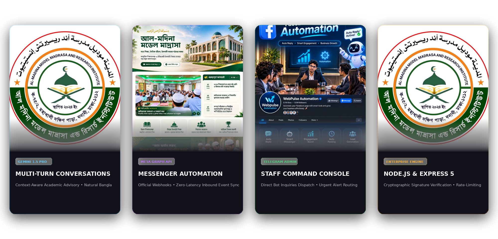

<div align="center">

# 🤖 AL-MODINA AUTOMATION — Multi-Platform AI Bot Engine
### Intelligent Conversational Social Operations Engine Powered by Google Gemini & Node.js

[](https://www.facebook.com/AlMadinaModelMadrasaAndResearchInstitute)
[](https://nodejs.org/)
[](https://ai.google.dev/)
[](https://developers.facebook.com/)
[](https://core.telegram.org/bots)
[](LICENSE)

<br/>

**[⚡ View Official Institution Page](https://www.facebook.com/AlMadinaModelMadrasaAndResearchInstitute)** &nbsp;•&nbsp; **[📦 GitHub Repository](https://github.com/labibfohayer/Al-Modina-Automation)**

<br/>



</div>

---

## 📌 Architectural Overview

**Al-Modina Automation** is an intelligent multi-platform conversational agent and social media workflow engine engineered for educational institutions. Powered by **Node.js (Express 5)** and **Google Gemini Large Language Models**, the system provides 24/7 automated parent advisory, admission support, and staff command dispatch.

The pipeline integrates Meta Graph API webhooks for Facebook Messenger and Page comment interactions with an interactive Telegram command bot providing administrative controls and urgent inquiry routing.

---

## ⚡ Key Engineering Highlights

1. **Context-Grounded Conversational Intelligence:**
   - Powered by **Google Gemini 1.5** with custom institutional domain grounding covering curricula (Play to Class 6), Hifz boarding guidelines, fee tables, and faculty rosters.
   - Natural bilingual conversation in Bengali and English with empathy-tuned cadence.

2. **Dual-Channel Webhook Ingestion Engine:**
   - Express 5 webhook listener handling Meta verification handshakes and incoming messaging payloads.
   - Cryptographic signature validation ensuring message authenticity and defense against replay attacks.

3. **Telegram Administrative Command Bot:**
   - Interactive remote console allowing administrators to review live conversational transcripts, generate social post captions, and dispatch broadcast announcements.

---

## 🛠️ Tech Stack & Production Architecture

| Component | Technologies | Purpose |
| :--- | :--- | :--- |
| **Runtime** | Node.js, Express 5 | High-concurrency event-driven server runtime |
| **AI Engine** | Google Gemini API (`@google/generative-ai`) | Zero-shot contextual reasoning and natural conversation |
| **Social API** | Meta Graph API v21.0 | Messenger and Page comment event integration |
| **Admin Channel** | Telegram Bot API (`node-telegram-bot-api`) | Real-time administrative notifications and remote control |
| **Scheduling** | node-cron | Automated social post drafting and routine daily announcements |

---

## 🚀 Getting Started & Local Development

```bash
# Clone the repository
git clone https://github.com/labibfohayer/Al-Modina-Automation.git
cd Al-Modina-Automation

# Install dependencies
npm install

# Configure environment variables (.env)
# Start bot server
npm start
```

---

## 📄 License
This project is open-source and distributed under the [MIT License](LICENSE).
